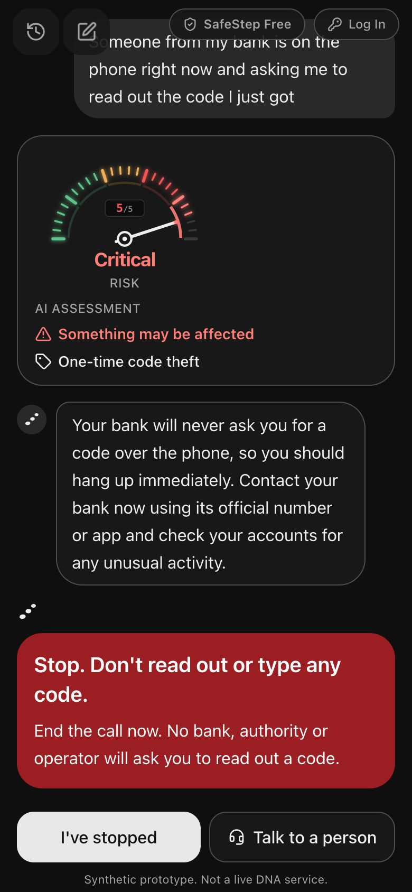
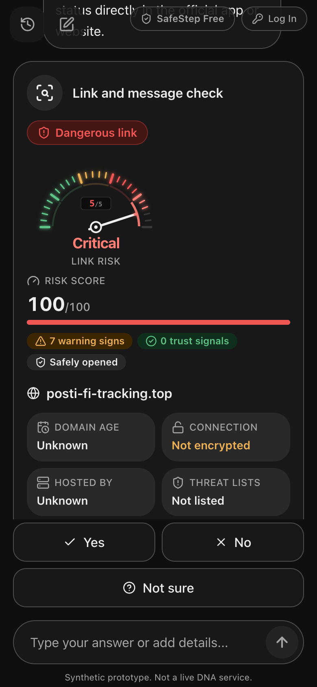
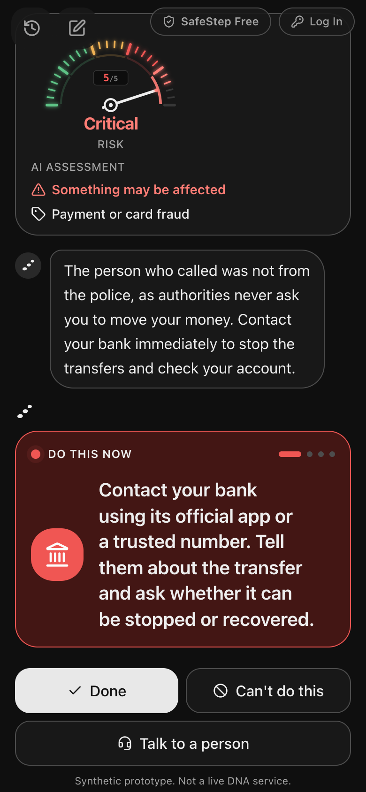
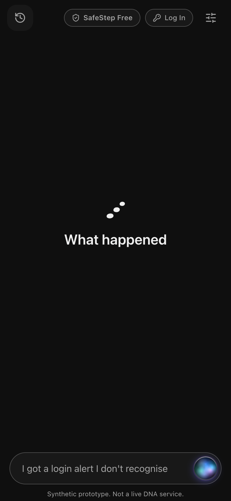
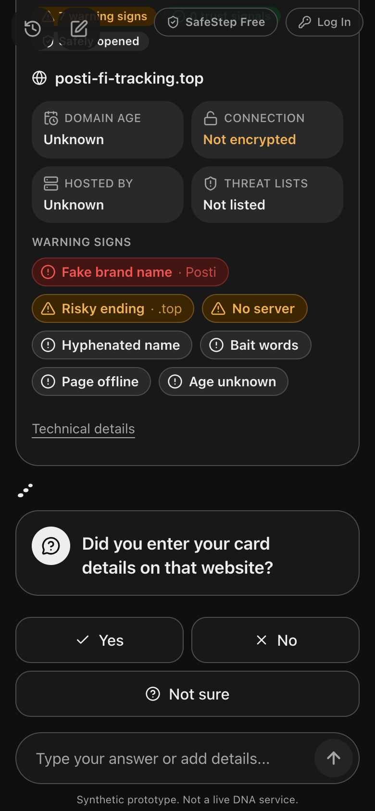
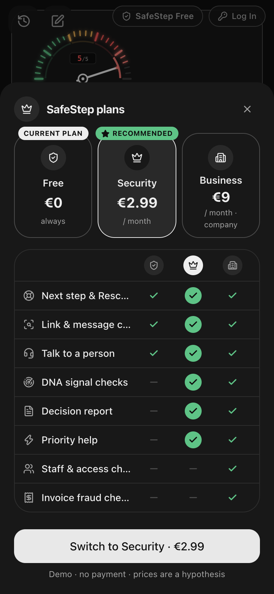
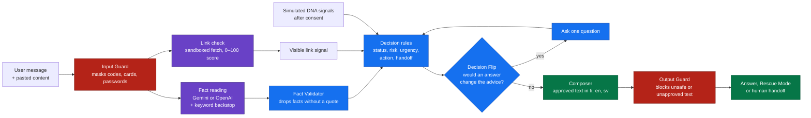
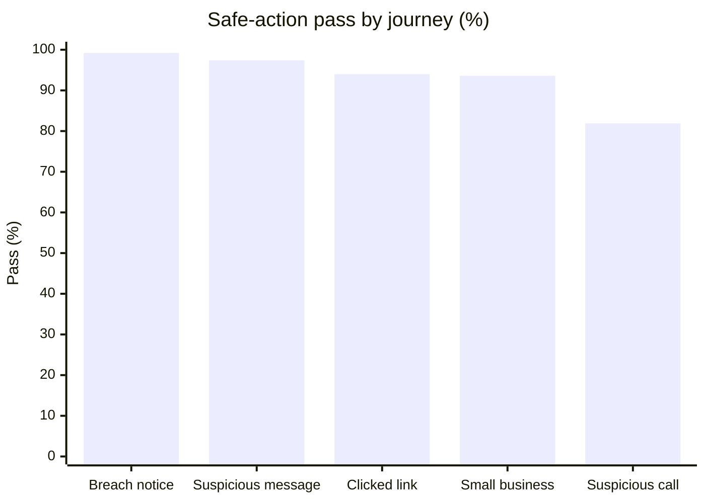

# SafeStep

SafeStep is an assistant for the moment after something looks wrong: a strange call, a text with a link, a login you don't recognise. It works out what happened, tells you to stop if harm is still happening, asks a question only when the answer would change the advice, and then gives one next step with the reason for it. It works in Finnish, English and Swedish, for both consumers and small businesses.

We built it for the DNA challenge at the Since AI Hackathon 2026 in Turku (6–8 November).

**Live demo:** [tblhacketon2026.vercel.app](https://tblhacketon2026.vercel.app) · **Demo video:** _link to be added_

> [!WARNING]
> This is a synthetic prototype, not a DNA service. All DNA signals, account data and human handoffs are simulated, and the advice is not official guidance from DNA or any authority.

<p align="center">
  
  &nbsp;
  
  &nbsp;
  
</p>

## Contents

- [What it does](#what-it-does)
- [Screenshots](#screenshots)
- [How it works](#how-it-works)
- [Safety rules](#safety-rules)
- [Running it locally](#running-it-locally)
- [Tests and evaluation](#tests-and-evaluation)
- [Results](#results)
- [From prototype to DNA service](#from-prototype-to-dna-service)
- [Business model](#business-model)
- [Project layout](#project-layout)
- [Known limits](#known-limits)
- [Team](#team)

## What it does

Security warnings usually stop at "this might be a scam". People are then left to decide for themselves whether to call the bank, change a password or ignore it. SafeStep tries to close that gap.

- **Stop first.** If something is happening right now, such as a caller still on the line, the app shows a Stop screen before anything else.
- **One question at most, usually none.** We call this Decision Flip: the engine runs both "yes" and "no" through the rules and asks only if the advice would differ. "Not sure" is a valid answer, and the advice then covers both cases.
- **Nothing is called safe without evidence.** Finding nothing suspicious is not enough to say a message is fine.
- **Link and message check.** Paste the message and SafeStep opens any link on the server as plain text, then scores it from 0 to 100 and lists the warning signs it found.
- **Rescue Mode.** When the damage is already done (money sent, code shared), it walks through recovery one step at a time.
- **Signal Unlock.** With the user's consent, it can use simulated DNA data such as recent SIM changes or logins, but only when that data would change the advice.
- **Talk to a person.** Hands over to DNA customer service with a case summary, which the user reads and approves first. Where the bank or police are the ones who can act, they are listed too.
- **Conversation and voice.** Gemini writes the replies in plain language, and every reply is checked against the decided steps. Voice input goes through the same engine as text.
- **Installable.** It is a PWA, and it shows emergency guidance when offline. The chat API is never cached on the device.

It covers the usual cases (bank, police and operator impostors, SIM takeover, phishing, clicked links, malicious apps, data breaches, unknown logins, invoice and CEO fraud, ransomware) and some less common ones: crypto seed-phrase and recovery scams, romance and "Hi mum" scams, marketplace links, QR codes, and sextortion, which always goes to a person.

## Screenshots

From the live demo at phone size.

| | | |
|:-:|:-:|:-:|
|  |  |  |
| Start: describe what happened | A caller wants a code right now | A parcel SMS with a fake Posti link |
|  |  |  |
| The one question that matters | Money already sent: call the bank | Plans (the safety help is always free) |

## How it works

The main design rule is that **the LLM reads and code decides**. The model turns free text into facts. Rules choose the risk, the action and whether a person is needed, and the model can't override them.



Red boxes are guards, purple is where text gets read (the LLM and link check), blue is deterministic code, and green is what the user sees.

1. The **Input Guard** masks card numbers, codes and passwords before anything else sees the text.
2. The LLM extracts facts. A keyword extractor runs alongside it and takes over if the LLM is down or rate-limited.
3. The **Fact Validator** throws away any fact that isn't backed by a quote from what the user wrote.
4. The **decision rules** choose status, risk, urgency, action and destination.
5. **Decision Flip** decides whether a question is worth asking.
6. The **Composer** builds the reply from approved text only, and the **Output Guard** blocks anything unsafe.

Here is what that looks like for one conversation:


## Safety rules

These are enforced in code, not in prompts. The full contract is in [DECISIONS.md](DECISIONS.md).

- The model never sets risk, urgency, action or escalation. Any outcome outside the action contract falls back to the cautious "unclear" path.
- "Safe" needs positive evidence. Text inside a scam message claiming it has been "verified safe" is ignored.
- DNA signals are read only after the user agrees, only when they would change the advice, and only for that session.
- SafeStep never blocks, pays or contacts anyone by itself. A handoff waits until the user has seen and approved the summary.
- Codes, card numbers and passwords are masked before they reach the LLM, the chat history or a handoff summary.
- Links are fetched as plain text. No scripts run, no forms are submitted, no cookies are kept, and private network addresses are refused.
- Stop advice, Rescue Mode and handoff to a person are free on every plan.

## Running it locally

You need Node.js 22 or newer. The evaluation scripts also need Python 3.10+.

```bash
npm install
cp .env.example .env.local   # add keys, or leave empty to run on keywords only
npm run dev
```

Then open <http://localhost:3000>. Without any API key the app still works, using the keyword extractor.

Every variable is optional. Put them in `.env.local`, which is gitignored, and never put real keys in `.env.example`.

| Variable | What it's for | Default |
|---|---|---|
| `GEMINI_API_KEY` | Fact reading and replies with Gemini. Used first if set | |
| `OPENAI_API_KEY` | OpenAI fallback, and speech to text | |
| `LLM_MODEL` | Use a different model | `gemini-3.5-flash-lite` (or `gpt-5.4-mini`) |
| `LLM_TIMEOUT_MS` | How long to wait before falling back to keywords | `8000` |
| `GOOGLE_SAFE_BROWSING_KEY` | Adds Google Safe Browsing to the link check | |
| `ELEVENLABS_API_KEY` | Spoken replies with ElevenLabs, falling back to OpenAI | |
| `ELEVENLABS_VOICE_ID`, `ELEVENLABS_MODEL` | ElevenLabs voice and model | `eleven_multilingual_v2` |
| `SESSION_TTL_MINUTES` | How long a session stays in memory | `30` |
| `NEXT_PUBLIC_API_URL` | API base URL if the UI runs separately | same origin |
| `SIMSET_DIR` | Path to the DNA SimSet, for evaluation only | |

The SimSet and the challenge brief come from the organisers and aren't included here.

Some things to try:

| Type this | What happens |
|---|---|
| "I got a text about my parcel", then paste *Posti: pay the €2.99 customs fee within 24h: https://posti-fi-tracking.top/pay* | Link check with a risk score, then advice |
| "Someone wants my seed phrase" | Crypto advice: never share it |
| "My wallet got drained" | Rescue Mode: move what's left, revoke approvals, report |
| "Someone called saying they were from my operator and asked for a code. I didn't give it." | Signal Unlock for recent SIM changes. It's locked on the Free plan; switch plans in Settings |
| "The police called and told me to move my money to a safe account. I already moved some." | Rescue Mode, starting with the bank |
| "Someone threatens to share my intimate photos unless I pay" | Handoff to a person, with the police listed |

In development you can open a single screen with sample data using `?screen=`, for example `/?screen=fallback`. Available screens: `stop`, `flip`, `describe`, `unlock`, `rescue`, `handoff`, `fallback`, `end`, `threat`, `unsure`, `safe`.

## Tests and evaluation

```bash
npm test                 # unit and attack tests (Vitest)
npm run typecheck
npm run build
npm run check:contract   # safety contract against all 588 SimSet dev cases
npm run eval:dev         # answers for the dev cases -> answers.jsonl
npm run eval:scenarios   # full conversations, 50 scenarios x 3 languages
npm run eval:frozen      # frozen paraphrase set
npm run eval:holdout     # paraphrases written after the rules were frozen
```

To score the answers with the organisers' evaluator:

```bash
python3 "$SIMSET_DIR/eval/evaluate.py" \
  --cases "$SIMSET_DIR/data/dev/cases.jsonl" \
  --submission answers.jsonl
```

`USE_LLM=1 npm run eval:dev` uses the LLM instead of keywords. Responses are cached in `.cache/`, so changing a rule doesn't cost new API calls. On a free tier, add `EVAL_CONCURRENCY=1 EVAL_PACE_MS=4500`.

## Results

All numbers below are from 8 November 2026, using the keyword extractor (no LLM) and the supplied evaluator v2.0.1. We tuned the rules on these same 588 development cases, so read them as what the logic can do, not as accuracy on cases it hasn't seen.

| Metric | Rules baseline | Target | SafeStep |
|---|---:|---:|---:|
| Safe-action pass | 60.5% | 80%+ | 94.4% |
| Unsafe statements | 0% | 0% | 0.0% |
| False alarms on harmless cases | 28.0% | under 10% | 9.8% |
| Escalation recall | 47.0% | 90%+ | 97.0% |
| Asked the decisive question | 70.0% | 90%+ | 96.7% |
| Consent violations | – | 0% | 0.0% |
| Weighted score (80 automated points) | 67.1 | 80+ | 94.0 |

```mermaid
xychart-beta
    title "Rules baseline vs SafeStep"
    x-axis ["Safe-action pass", "Escalation recall", "Decisive question", "Weighted score"]
    y-axis "Score (%)" 0 --> 100
    bar [60.5, 47.0, 70.0, 67.1]
    bar [91.2, 90.9, 93.3, 94.0]
```



In each pair, the left bar is the supplied baseline and the right bar is SafeStep.

On the brief's criteria the evaluator gives correctness 93.7, clarity 97.2, uncertainty and escalation 92.0, and privacy and consent 93.1. The remaining 20% (working implementation) is judged by people.

By journey:



| Journey | Cases | Safe-action pass |
|---|---:|---:|
| Breach notice | 120 | 99.2% |
| Suspicious message | 156 | 97.4% |
| Clicked link | 84 | 94.0% |
| Small-business incident | 156 | 93.6% |
| Suspicious call | 72 | 81.9% |

Consumer cases pass 95.5% and small-business cases 92.2%. Most misses in the weaker journeys are over-reactions (sending someone to the bank as a precaution) rather than unsafe advice.

The five sample journeys from `five_journeys.jsonl` pass **5 of 5** (weighted proxy 98.2), with no unsafe statements and every needed escalation made. The supplier case used to fail: SafeStep led with the "already paid" branch even though the user was asking whether to pay. A request to pay, or asking "can I pay?", is now read as "not paid yet", so the answer leads with "don't pay, verify the new account by phone".

Other runs:

| Run | Result |
|---|---|
| Full conversations (`eval:scenarios`) | 116 of 150, no severe failures (no scam called safe, no missed live danger, no leaked secret) |
| Multi-turn simulator (`sim/run_conversation.py`, 588 conversations) | 89.8% safe-action, 0% unsafe, 94.1% escalation recall, weighted 91.8 (baseline 65.3%, 69.1) |
| Test set, 335 inputs | Predictions in `test_predictions.jsonl`, accepted by the supplied validator |
| Safety contract | 588 cases, no breaches |
| Unit tests | 555 passing |

<details>
<summary>Failure and escalation examples</summary>

- Escalation: "Someone threatens to share my intimate photos unless I pay" goes to a person, with the police listed and advice not to pay, to keep evidence and to report the account.
- Fixed failure: a bank impostor mentioning "suspicious payments" was read as an unknown card charge, which sent 8 call cases to the wrong action. The card-charge pattern now runs after the call pattern.
- Fixed failure: the Finnish line "Kerroit jakaneesi koodin" ("You said you shared a code") matched the evaluator's "tells the user to share a code" check in 10 answers. We reworded it.
- Still open: 31 over-reactions and 13 false alarms on harmless cases, mostly real operator and bank notices that get sent to a precautionary check.

</details>

<details>
<summary>Review status</summary>

- Safety review: a manual review by a team member rated 18 of 20 sampled answers safe, 2 incomplete and none unsafe; both incomplete answers were fixed afterwards ([details](eval/RESULTS.md)). The sheet for the human review is in [review/](review/README.md).
- Comprehension: the test with people outside the team is set up in [review/comprehension-check.md](review/comprehension-check.md).

</details>

More detail is in [eval/RESULTS.md](eval/RESULTS.md) and, in the organisers' format, [RESULTS.md](RESULTS.md).

## From prototype to DNA service

None of this is connected to real DNA systems. This is how we think it would fit:

| Part | In the prototype | In DNA's services |
|---|---|---|
| Entry point | Web app at `/` | An "Is this a scam?" entry in the DNA app and Oma portal, opened from a call warning or flagged SMS |
| Identity | Mock login (`lib/mock-users.ts`) | The existing DNA login, so no sign-up and no identity questions |
| Signals | Simulated (`adapters/signals.ts`), behind consent | DNA APIs for SIM and eSIM events, logins and call warnings, behind the same consent step |
| Link check | Server-side fetch (`adapters/link-scan.ts`) | An isolated scanning service plus DNA's threat feeds |
| Handoff | Simulated summary (`adapters/handoff.ts`) | A ticket in DNA customer service or business security support |
| Sessions | In memory, cleared at the end | DNA's retention rules; the report saved only if the user wants it |
| Plans | Demo switch | Part of DNA's security bundle, or added to a DNA Business subscription |

The UI talks to the engine through a single API (`/api/sessions`). The DNA app could call the same API, and each simulated adapter can be replaced without touching the decision rules.

## Business model

The idea is to run SafeStep inside DNA's app, where users are already logged in, as an extension of DNA's existing security bundle (built on F-Secure). Prices are a hypothesis. [BUSINESS.md](BUSINESS.md) has the reasoning and sources.

| Plan | Price (hypothesis) | Includes |
|---|---|---|
| Free, in the DNA app | €0 | Next step, link check, Rescue Mode, handoff to a person |
| DNA Security bundle | €2.99 / month | DNA signal checks, decision report, priority help |
| DNA Business Security | €9 / month per company | Staff-account and invoice-fraud checks, business security support |

## Project layout

```text
app/          Next.js pages and API routes (/api/sessions is the main flow)
components/   UI: chat, link check card, plans, report, voice mode
engine/       Rules, Decision Flip, fact reading, composer, guards
adapters/     LLM, link scanner, simulated DNA signals, handoff, session store, voice
content/      Approved text in Finnish, English and Swedish
lib/          Client API, mock users, plans, UI text
eval/         Evaluation runners and scenarios
review/       Safety review and comprehension sheets
tests/        Unit and attack tests
docs/         Screenshots
```

Built with TypeScript, Next.js 16, React 19, Tailwind CSS 4 and Zod. The LLM is Gemini (`gemini-3.5-flash-lite`) or OpenAI (`gpt-5.4-mini`), with a keyword extractor as backup. Tests run on Vitest, plus the organisers' Python evaluator.

Other docs:

- [ARCHITECTURE.md](ARCHITECTURE.md): components, data flow, API, LLM layer, security and privacy
- [DECISIONS.md](DECISIONS.md): action contract, safety rules and the decision log
- [strategy.md](strategy.md): product strategy and stages
- [TASKS.md](TASKS.md): team plan and status

## Known limits

- Sessions are sealed and passed between requests so they survive serverless hosts, but there is no shared store yet. A production deployment would use one, under DNA's retention rules.
- The link check reaches the open internet from the server. In production it should run in an isolated network.
- Plans are a demo switch with hypothetical prices. There is no billing.
- The Finnish and Swedish text still needs a native speaker to review it.
- The free Gemini tier allows 15 requests a minute. Beyond that, the app falls back to keywords.
- Masking can miss codes that mix letters and numbers, or codes with no code word nearby.
- Swedish source titles fall back to English, because the supplied guidance has none in Swedish.
- Full conversations pass 116 of 150. Most misses happen when the simulator answers "Not sure" to "Did you transfer money?" and SafeStep takes the cautious path.

## Team

- Mehrab: safety engine, API and evaluation
- Arsham: product, UI, accessibility and usability

Thanks to DNA Oyj for the challenge and the SimSet, and to Since AI for running the hackathon.

## License

[MIT](LICENSE)
