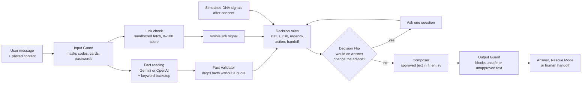

# SafeStep

**Digital Security Assistant: What should I do now?**

SafeStep helps consumers and small businesses act on a suspicious call, message, link or account problem. It reads what happened, stops ongoing harm first, asks only the question that would change the advice, and gives one clear, proportionate next step, with the reason behind it and a human handoff when needed.

Built for the **DNA challenge at the Since AI Hackathon 2026** (Turku, 6–8 November).

> **Synthetic prototype.** This is not a live DNA service. All DNA signals, account data and human handoffs are simulated, and the guidance is not official advice from DNA or any authority.

| | |
|---|---|
| **Demo video** | _Add the link here before submitting_ |
| **Business hypothesis** | [BUSINESS.md](BUSINESS.md) |
| **Evaluation detail** | [eval/RESULTS.md](eval/RESULTS.md) |
| **Safety contract** | [DECISIONS.md](DECISIONS.md) |
| **Architecture** | [ARCHITECTURE.md](ARCHITECTURE.md) |

---

## At a glance

| | Result | Target |
|---|---:|---:|
| Safe-action pass (588 dev cases) | **91.2%** | 80%+ |
| Unsafe statements | **0.0%** | 0% |
| False alarms on harmless cases | **9.8%** | under 10% |
| Escalation recall | **90.9%** | 90%+ |
| Consent violations | **0.0%** | 0% |
| Weighted brief score (automated 80 points) | **92.6** | 80+ |

Measured with the supplied evaluator v2.0.1. Details and caveats are in [Results](#results).

---

## What it does

| Feature | What the user gets |
|---|---|
| **Clear next step** | One action first, then why it matters, in Finnish, English or Swedish. |
| **Stop the harm first** | If something is happening now, like a caller still on the line, SafeStep shows a Stop screen before anything else. |
| **Only the question that matters** | Decision Flip runs Yes and No through the rules and asks only if the answer would change the advice. |
| **Honest uncertainty** | "Not sure" keeps the fact unknown, and the advice covers both answers. Nothing is called safe without positive evidence. |
| **Link and message check** | When someone says they received something, SafeStep asks them to paste it, opens any link safely on the server and gives it a 0–100 risk score. |
| **Rescue Mode** | Step-by-step recovery for incidents that already happened, such as money sent or a code shared. |
| **Signal Unlock** | Uses simulated DNA data (SIM changes, logins, device findings) only after consent, and only when it would change the advice. |
| **Natural conversation** | Gemini replies to every message in the user's own terms and answers their questions in context. Every reply is checked: it can't contradict the steps, call anything safe unless the rules did, or ask for codes. |
| **Talk to DNA** | "Talk to a person" opens DNA Customer Service by chat or call-back, with a case number and a summary the user approves before it's sent. The bank or police are shown as extra contacts when they're the ones who can act. |
| **Decision report** | A record of what was understood, what was decided and why, with sources. |
| **Plans** | A demo switch showing how DNA could package the service. Safety advice is free on every plan. |

### Scam coverage

Bank, police and operator impostor calls, SIM and eSIM takeover, phishing SMS and email, parcel and tax lures, clicked links, malicious apps and remote access, data breaches, unknown logins, MFA fatigue, invoice and CEO fraud, ransomware, former-staff access, and partner monitoring. In addition:

- **Crypto:** seed-phrase requests, drained wallets, withdrawal fees and recovery scams, each with its own rules and advice.
- **People asking for money:** investment, romance, "Hi mum, new number", job and task scams, lottery and inheritance fees, gift cards.
- **Shopping and accounts:** marketplace courier links, fake shops, QR codes, social-account takeovers, unknown card charges, identity theft.
- **Sextortion and blackmail:** handed to a human advisor, with the police listed.

---

## How it works

**The LLM reads. Code decides.**



1. **Input Guard** masks card numbers, codes and passwords before anything else sees them.
2. **Fact reading:** the LLM turns the user's words into structured facts. A keyword extractor runs beside it and takes over if the LLM fails or is rate-limited.
3. **Fact Validator** drops any fact that isn't backed by a real quote from the user's text.
4. **Decision rules** choose the status, risk, urgency, action and human destination. The LLM can't set any of these.
5. **Decision Flip** asks a question only when Yes and No lead to different advice.
6. **Composer** builds the reply only from approved text, and the **Output Guard** blocks anything unsafe before it is shown.

---

## Safety boundaries

- **The model never decides.** Risk, urgency, action and escalation come from rules checked against an action contract. An outcome outside the contract becomes the cautious "unclear" path.
- **No unjustified reassurance.** "Safe" needs positive evidence. Finding nothing risky is never enough, and text inside a scam message that claims to be "verified safe" is ignored.
- **Consent before data.** DNA signals are read only after the user agrees, only when they would change the advice, and only for that session.
- **No irreversible action.** SafeStep never blocks, pays or contacts anyone by itself. Every handoff shows the summary first and waits for approval.
- **Secrets stay out.** Codes, card numbers and passwords are masked before the LLM, the chat history and the handoff summary.
- **Sandboxed link check.** Links are fetched as plain text: no scripts run, nothing is submitted, no cookies are kept, and private or internal network addresses are refused.
- **Safety is never behind a paywall.** Stop-the-harm advice, Rescue Mode and human handoff are free on every plan.

---

## Try it

```bash
npm install
cp .env.example .env.local   # add a GEMINI_API_KEY, or leave it empty for keyword mode
npm run dev
```

Open <http://localhost:3000> and try these:

| Type this | What you'll see |
|---|---|
| *I got a text about my parcel*, then paste: *Posti: pay the €2.99 customs fee within 24h: https://posti-fi-tracking.top/pay* | The paste step, then the link and message check with a risk score, then the advice |
| *Someone wants my seed phrase* | Crypto-specific advice: never share it |
| *My wallet got drained* | Rescue Mode: move what's left to a new wallet, revoke approvals, report |
| *Someone called saying they were from my operator and asked for a code. I didn't give it.* | Signal Unlock for recent SIM changes. On the Free plan it shows a lock; switch plans from the chip in the top bar |
| *The police called and told me to move my money to a safe account. I already moved some.* | Rescue Mode, with contacting the bank as the first step |
| *Someone threatens to share my intimate photos unless I pay* | Handoff to a human advisor, with the police listed |

In development, `?screen=` opens a single screen with example data, for example `/?screen=fallback`. The options are `stop`, `flip`, `describe`, `unlock`, `rescue`, `handoff`, `fallback`, `end`, `threat`, `unsure` and `safe`.

### Configuration

You need Node.js 22 or newer. The evaluation commands also need Python 3.10 or newer.

| Variable | Purpose |
|---|---|
| `GEMINI_API_KEY` | Fact reading with Gemini. Used first if set |
| `OPENAI_API_KEY` | Fact reading with OpenAI, if there is no Gemini key |
| `GOOGLE_SAFE_BROWSING_KEY` | Optional. Adds Google Safe Browsing to the link check |
| `SIMSET_DIR` | Full path to the DNA SimSet folder, needed for evaluation only |

With no key, the app runs on the keyword extractor alone. The SimSet and challenge brief come from the organisers and aren't in this repository.

---

## Results

All numbers are from 8 November 2026, with the keyword extractor (no LLM), scored by the supplied evaluator v2.0.1. The rules were tuned on the development cases, so these show what the logic can reach, not accuracy on unseen cases.

### Development set (588 cases)

| Metric | Rules baseline | Target | SafeStep |
|---|---:|---:|---:|
| Safe-action pass | 60.5% | 80%+ | **91.2%** |
| Unsafe statements | 0% | 0% | **0.0%** |
| False alarms on harmless cases | 28.0% | under 10% | **9.8%** |
| Escalation recall | 47.0% | 90%+ | **90.9%** |
| Asked decisive question | 70.0% | 90%+ | **93.3%** |
| Consent violations | — | 0% | **0.0%** |
| Weighted brief proxy | 67.1 | 80+ | **92.6** |

Brief criteria (automated proxy): correctness 91.5, clarity 96.4, uncertainty and escalation 90.0, privacy and consent 93.1.

| Journey | Cases | Safe-action pass |
|---|---:|---:|
| Breach notice | 120 | 98.3% |
| Suspicious message | 156 | 97.4% |
| Clicked link | 84 | 94.0% |
| Small-business incident | 156 | 82.1% |
| Suspicious call | 72 | 81.9% |

Consumers pass 95.2% and small businesses 82.8%. Most misses in the weaker journeys are over-reactions, such as sending a cautious check to the bank, rather than unsafe advice.

### The five sample journeys

The supplied `five_journeys.jsonl` passes **4 of 5**, with no unsafe statements and every needed escalation made. The miss is a supplier asking to be paid to a new bank account. The message doesn't say whether the invoice was paid, so SafeStep covers both cases ("if the payment already left, call your bank's fraud line; if not, don't pay and verify the new account"), and the evaluator scores the paid branch as an over-reaction.

### Other runs

| Run | Result |
|---|---|
| Full conversations (`npm run eval:scenarios`, 50 scenarios × 3 languages) | **116 / 150**, 0 severe failures (scam called safe, missed live danger, secret leaked) |
| Test set (335 inputs) | Predictions in `test-predictions.jsonl`, accepted by the supplied validator |
| Safety contract (`npm run check:contract`) | 588 cases, 0 breaches |
| Unit tests | 546 passing |

### Failure and escalation examples

- **Escalation:** "Someone threatens to share my intimate photos unless I pay" goes to a human advisor, with the police listed and the advice not to pay, to keep evidence and to report the account.
- **Failure, fixed:** a bank-impostor caller mentioning "suspicious payments" was read as an unknown card charge, sending 8 call cases to the wrong action. The charge pattern now runs after the call pattern.
- **Failure, fixed:** the Finnish line "Kerroit jakaneesi koodin" ("You said you shared a code") was flagged by the evaluator as telling users to share a code, in 10 answers. It was reworded.
- **Remaining:** 31 over-reactions and 13 false alarms on harmless cases, mostly genuine operator and bank notices sent to a cautious check.

### Review status

- **Safety review:** an AI-assisted first pass scored 18 of 20 sampled answers safe, 2 incomplete and 0 unsafe ([details](eval/RESULTS.md)). The human review sheet is in [review/](review/README.md).
- **Comprehension:** the check with people outside the team is prepared in [review/comprehension-check.md](review/comprehension-check.md).

---

## Evaluate

```bash
npm test                 # unit tests
npm run typecheck
npm run check:contract   # safety contract against the SimSet
npm run eval:dev         # answers for the 588 dev cases -> answers.jsonl
npm run eval:scenarios   # full multi-turn conversations
```

Score the answers with the supplied evaluator (set `SIMSET_DIR` in your shell first):

```bash
python3 "$SIMSET_DIR/eval/evaluate.py" \
  --cases "$SIMSET_DIR/data/dev/cases.jsonl" \
  --submission answers.jsonl
```

Add `USE_LLM=1` to `eval:dev` to use the LLM instead of keywords. Results are cached in `.cache/`, so rule changes rerun without new calls. On a free API tier, slow the run with `EVAL_CONCURRENCY=1 EVAL_PACE_MS=4500`.

---

## Integration path

How SafeStep could move from prototype to a DNA service. None of this is built against live DNA systems.

| Step | Prototype today | In DNA's services |
|---|---|---|
| **Entry point** | Web app at `/` | A "Is this a scam?" entry in the DNA app and Oma portal, opened from a call warning or a flagged SMS |
| **Identity** | Mock login (`lib/mock-users.ts`) | The user's existing DNA login, so no extra sign-up and no identity questions |
| **Signals** | Simulated data (`adapters/signals.ts`) behind consent | DNA APIs for SIM and eSIM events, account logins and call warnings, behind the same consent screen and only when they change the advice |
| **Link check** | Server-side fetch (`adapters/link-scan.ts`) | An isolated scanning service, plus DNA's own threat feeds |
| **Human handoff** | Simulated summary (`adapters/handoff.ts`) | A ticket in DNA customer service or business security support, with the summary the user approved |
| **Sessions** | In-memory, cleared at the end | DNA's data-retention rules; the decision report saved only if the user chooses |
| **Plans** | Demo switch | Included in DNA Digiturva / Turvapaketti, or added to a DNA Business subscription |

The engine already talks to the UI only through one API (`/api/sessions`), so the DNA app can call the same API, and each simulated adapter can be swapped for a real one without changing the decision rules.

---

## Business model

SafeStep is designed to sit inside DNA's app and portal, where users are already identified, and to extend DNA's existing security bundle (built on F-Secure). The hypothesis, with sources, is in [BUSINESS.md](BUSINESS.md):

| Plan | Price (hypothesis) | Adds |
|---|---|---|
| Free, in the DNA app | €0 | Next step, link check, Rescue Mode, human handoff |
| DNA Security bundle | €2.99 / month | DNA signal checks, decision report, priority help |
| DNA Business Security | €9 / month per company | Staff-account and invoice-fraud checks, business security support |

---

## Project structure

```
app/            Next.js app and API routes (/api/sessions is the main flow)
components/     UI: chat turns, link check card, plans sheet, report, voice mode
engine/         Rules, Decision Flip, fact reading, composer, guards
adapters/       LLM, link scanner, simulated DNA signals, session store
content/        Approved text in Finnish, English and Swedish
eval/           Evaluation runners, scenarios and RESULTS.md
review/         Safety review and comprehension check sheets
tests/          Unit and attack-hardening tests
```

## Documentation

| File | Contents |
|---|---|
| [ARCHITECTURE.md](ARCHITECTURE.md) | Components, data flow, API, LLM layer, security and privacy |
| [DECISIONS.md](DECISIONS.md) | Action contract, safety rules, decision log |
| [eval/RESULTS.md](eval/RESULTS.md) | Full evaluation results and the five journeys |
| [BUSINESS.md](BUSINESS.md) | Packaging and pricing hypothesis |
| [strategy.md](strategy.md) | Product strategy and stages |
| [TASKS.md](TASKS.md) | Team plan and status |

## Known limits

- The link check reaches the open internet from the server. In production it should run in an isolated network.
- Plans are a demo switch with hypothesis prices, not billing.
- Finnish and Swedish text still needs review by native speakers.
- The free Gemini tier allows 15 requests a minute. Above that, the app falls back to the keyword extractor.
- Masking can miss letter-and-number codes and codes with no code word nearby.
- Swedish source titles fall back to English, because the supplied guidance has no Swedish titles.
- Full conversations pass 116 of 150. Most misses come from the simulator answering "Not sure" to "Did you transfer money?", where SafeStep takes the cautious path.

## Licence

[MIT](LICENSE)
